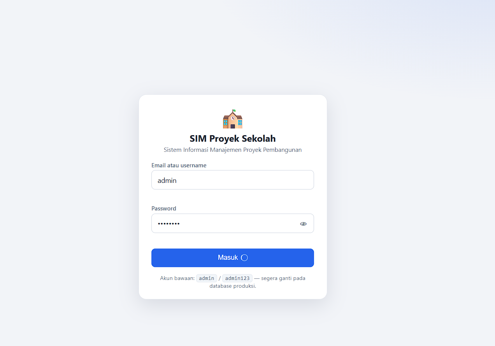
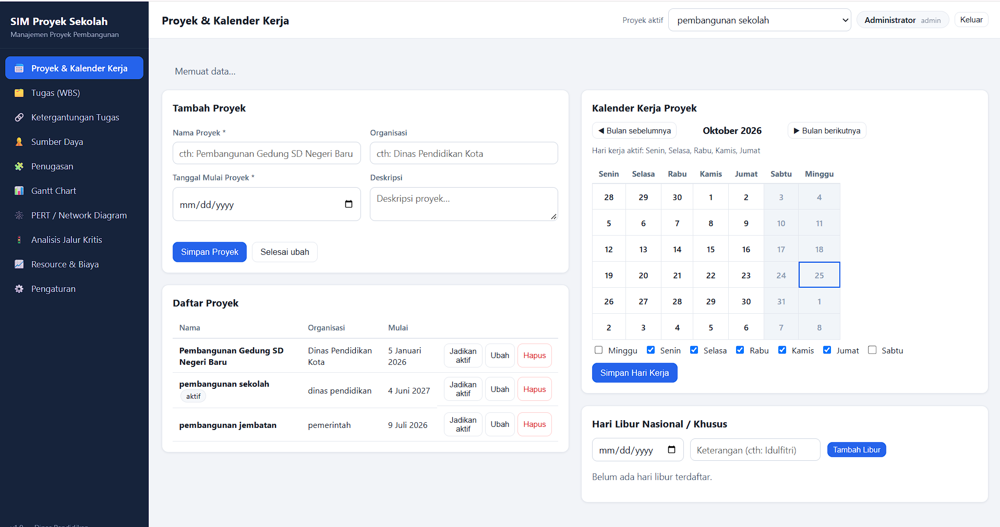

# Sistem Informasi Manajemen Proyek Pembangunan Sekolah

Aplikasi web untuk merencanakan dan mengendalikan proyek pembangunan sekolah: konstruksi gedung,
pengadaan perabot dan buku, serta rekrutmen guru dan staf. Seluruh antarmuka berbahasa Indonesia.


## Tampilan Aplikasi

### Halaman Login


### Halaman Utama


## Teknologi

- **Backend**: Node.js + Express + SQLite (`better-sqlite3`). Database otomatis dibuat & di-seed
  dengan data contoh saat pertama kali dijalankan (file `data/app.db`).
- **Frontend**: HTML, CSS, JavaScript murni (tanpa framework/build). Satu-satunya library eksternal:
  Chart.js (CDN) untuk resource & biaya chart. Gantt dan PERT digambar manual dengan SVG.
- **Penjadwalan**: modul `server/scheduler` — fungsi murni CPM (forward/backward pass), kalender
  kerja, lag FS/SS, cuti anggota. Dipakai bersama oleh Gantt, PERT, analisis jalur kritis, dan
  resource chart.
- **Login & keamanan**: tanpa dependensi tambahan — password di-hash dengan **scrypt**
  (`crypto` bawaan Node), sesi berupa token acak yang disimpan di SQLite (hanya **hash SHA-256**
  token yang disimpan) dan dikirim sebagai cookie **HttpOnly + SameSite=Lax**, dibuat ulang dalam
  7 hari. Semua endpoint `/api/*` selain `/api/auth/*` dilindungi middleware `authGuard` di server.
  Percobaan login gagal dibatasi (rate-limit): 5x gagal berturut-turut mengunci 1 menit.

## Cara instal dan menjalankan

```bash
npm install
npm start
```

Lalu buka **http://localhost:3000** di browser.

**Login**: Anda akan diarahkan ke halaman **Masuk**. Gunakan akun bawaan:

- Username: `admin` — Password: `admin123` (atau email `admin@simpro.local`)

Ganti data di tabel `users` (kolom `password_hash`, format scrypt) untuk produksi. Gunakan fitur
**Keluar** di pojok kanan atas untuk mengakhiri sesi.

Catatan: `npm install` akan meng-compile modul native `better-sqlite3` (perlu Node.js >= 18; pada
Windows disarankan sudah terpasang Git for Windows / build tools standar npm).

Jalankan unit test scheduler dan autentikasi dengan:

```bash
npm test
```

`tests/auth.test.js` menguji fungsi hash/verifikasi password scrypt; `tests/scheduler.test.js`
menguji forward/backward pass, lag FS/SS, dan kalender libur.

## Struktur folder

```
server/
  server.js           # entry point Express, static file /public
  db.js               # skema SQLite + seed data contoh + reset (+ tabel users & sessions)
  auth.js             # sesi login (cookie HttpOnly), guard middleware, rate limit
  password.js         # hash/verifikasi password scrypt (crypto bawaan Node)
  routes/             # REST API: auth, projects, calendar, tasks, deps, members, assignments, analysis
  scheduler/
    calendar.js       # kalender kerja (hari kerja, libur, cuti) — fungsi murni
    cpm.js            # CPM: forward pass, backward pass, slack, jalur kritis — fungsi murni
    resources.js      # beban kerja/biaya anggota dari hasil jadwal — fungsi murni
public/               # antarmuka (JS module murni, tanpa framework)
public/login.html     # halaman masuk (publik)
tests/                # unit test scheduler & autentikasi (node:test bawaan Node)
data/app.db           # database SQLite (dibuat otomatis)
```

## Tampilan Aplikasi (Screenshots)


> Letakkan file tangkapan layar Anda di folder `screenshots/` dengan nama di atas
> (mis. `dashboard.png` = tampilan setelah login, `gantt.png` = Gantt Chart,
> `pert.png` = PERT/Network Diagram). Minimal satu file diperlukan.

## Modul

1. **Proyek & Kalender** — CRUD proyek, pilih proyek aktif (header), kalender kerja per proyek
   (hari kerja Senin–Minggu, libur nasional/khusus, tampilan bulanan). Semua perhitungan jadwal
   memakai kalender ini.
2. **Tugas (WBS)** — pohon tugas dengan kode otomatis (1, 1.1, …), tugas induk menghitung tanggal &
   progres rata-rata berbobot durasi, filter/pencarian, prioritas, penanggung jawab.
3. **Ketergantungan** — predecessor FS/SS dengan lag hari kerja (boleh negatif), deteksi & penolakan
   dependency melingkar / diri sendiri / duplikat.
4. **Sumber Daya** — CRUD anggota (nama, kontak, peran, gaji per hari), cuti pribadi, halaman
   detail beban & biaya.
5. **Penugasan** — multi penugasan anggota pada tugas leaf dengan % alokasi, peringatan kelebihan
   beban & hari cuti.
6. **Visualisasi** — Gantt chart SVG (pohon + timeline, akhir pekan/libur diarsir, panah FS/SS,
   zoom, tooltip, garis "hari ini", kritis merah) dan PERT chart / network diagram SVG (ES, EF,
   LS, LF, slack per node, zoom & pan, node Mulai/Selesai).
7. **Analisis Jalur Kritis** — tabel CPM lengkap, daftar jalur kritis, ringkasan proyek, dan
   simulasi keterlambatan tanpa mengubah data.
8. **Resource Chart** — histogram Chart.js (harian/mingguan, % atau jam), garis kapasitas 100%,
   tabel ringkasan & status, estimasi biaya tenaga kerja + grafik biaya, filter peran/anggota/tanggal.

## Login, proteksi, dan logout

- Halaman `login.html` bersifat publik; seluruh data aplikasi berada di balik API yang dilindungi
  middleware `authGuard` di server, jadi perlindungan tidak bergantung pada frontend.
- Sesi disimpan di tabel `sessions` (hash SHA-256 dari token acak 32 byte, kedaluwarsa 7 hari);
  cookie `simpro_sid` HttpOnly tidak dapat dibaca JavaScript.
- Setelah logout (tombol **Keluar** di header), sesi dihapus dari database dan cookie dikosongkan;
  akses ke halaman/data terlindungi tanpa login tidak mungkin (API mengembalikan 401 dan frontend
  mengalihkan ke halaman masuk).
- Tabel `users` & `sessions` dibuat dengan `CREATE TABLE IF NOT EXISTS` sehingga data lain tidak
  terganggu (migrasi aman pada database lama). Reset data contoh **tidak** menghapus akun.

## Algoritma CPM (ringkas)

1. **Kalender**: daftar hari kerja proyek dibangkitkan dari tanggal mulai (Senin–Minggu yang
   dicentang, tanpa tanggal libur). Untuk tiap tugas, hari di mana anggota yang ditugaskan sedang
   cuti **tidak dihitung** sebagai hari kerja tugas tersebut.
2. **Forward pass** (urut topologis): ES tugas = hari kerja tersedia setelah semua kendala
   predecessor — `FS+lag`: mulai paling awal ≥ (EF preditor + lag hari kerja + 1); `SS+lag`: ≥
   (ES preditor + lag). EF = ES + durasi − 1 pada daftar hari kerja tersedia tugas.
3. **Backward pass**: LF/LS dihitung mundur dari akhir proyek; tugas tanpa penerus LF = akhir
   proyek. Untuk FS: LF preditor ≤ LS penerus − lag − 1; untuk SS: LS preditor ≤ LS penerus − lag.
4. **Total float** LS − ES; float = 0 → tugas **kritis**. Jalur kritis = rangkaian tugas kritis
   dari awal ke akhir (bisa lebih dari satu).
5. Tanggal dalam aplikasi selalu dalam hari kerja kalender proyek, mis. lag 7 pada FS setelah
   pengecoran = 7 hari kerja masa curing.

## Reset data contoh

Buka menu **Pengaturan → Reset ke data contoh** (konfirmasi terlebih dahulu). Atau hapus file
`data/app.db` lalu jalankan ulang `npm start` — database akan dibuat dan di-seed ulang otomatis
(akun login bawaan `admin`/`admin123` dibuat ulang otomatis).

## Ekspor

Menu **Pengaturan → Ekspor jadwal (CSV)** mengunduh jadwal proyek aktif berformat CSV (bom UTF-8,
bisa dibuka di Excel).

## Catatan data contoh

Tanggal hari libur nasional 2026 pada data contoh adalah perkiraan untuk proyek demo (mis. Idulfitri,
Idul Adha, Awal Ramadan); silakan sesuaikan di halaman Proyek & Kalender.
